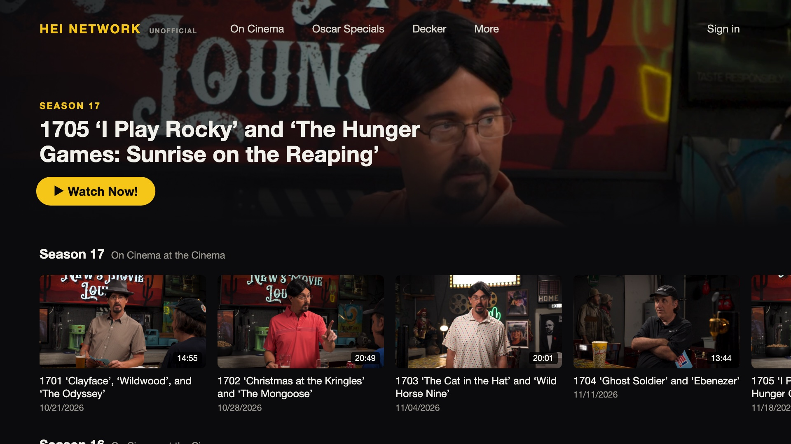

# HEI Network for LG webOS (unofficial)

A remote-friendly TV app for watching [HEI Network](https://www.heinetwork.tv/) on LG webOS TVs.
HEI Network has apps for Apple TV, Android TV and Fire TV, but not for LG; this fills that gap.

**This is an unofficial, fan-made client.** It is not affiliated with, endorsed by, or supported by
HEI Network. You need your own HEI Network account, and the app only plays what that account can
already watch.



## What it does

- Home screen with the featured episode, latest seasons and a "Continue watching" row
- Browse shows → seasons → episodes with the arrow keys or the Magic Remote pointer
- Sign in with a QR code / activation code confirmed on your phone — no password typed on the TV
- Player with seek, pause, resume from where you left off (synced with your account), and
  automatic "up next"

## Remote controls

| Key | Browsing | Playing |
|---|---|---|
| Arrows | Move | ◀ ▶ seek 10 s (hold to go further) |
| OK | Open | Play / pause |
| ⏪ ⏩ | | Seek 30 s |
| Back | Previous screen / exit | Stop and return |

## Installing

The app is not in the LG Content Store, so it is installed through LG's Developer Mode. No root is
needed.

1. Create a free account at [webostv.developer.lge.com](https://webostv.developer.lge.com/).
2. On the TV, install the **Developer Mode** app from the LG Content Store, sign in, turn on
   **Dev Mode Status** (the TV restarts), then turn on **Key Server**.
3. On a computer, install [webOS Dev Manager](https://github.com/webosbrew/dev-manager-desktop/releases/latest),
   add your TV using the IP address and passphrase shown in the Developer Mode app.
4. Download the `.ipk` from this repository's [Releases](../../releases/latest) and install it with
   Dev Manager (**Apps → Install**).

Developer Mode sessions expire (after roughly 1,000 hours) and LG removes sideloaded apps when
they do. Renew the session from the Developer Mode app, or with Dev Manager, before it lapses.

## Building from source

There is no build step; the app is plain HTML, CSS and JavaScript in `app/`.

```sh
npm install -g @webos-tools/cli
ares-setup-device            # add your TV, then: ares-novacom --device <name> --getkey
DEVICE=<name> ./deploy.sh    # package, install and launch
```

## How it works

The app talks to the same REST API the official HEI Network apps use
(`https://www.heinetwork.tv/wp-json/hei-app/v1`): the catalogue is public, sign-in uses the site's
activation-code flow, and stream URLs are only returned for a signed-in account. Watch progress is
read from and saved to the site's `video-progress/v1` endpoints. Your login token is stored only
in the app's local storage on your TV. Video is played with the TV's native HLS player.

Because this relies on an API that is not documented for third parties, it can break whenever the
site changes.

## Status

Tested on an LG OLED C2 and an OLED C5. Version 0.3.2 fixes the layout on 2020 models (webOS 5), which is reported but not yet confirmed. Other models are untested.

## Licence

MIT — see [LICENSE](LICENSE). "HEI Network" and "On Cinema at the Cinema" are the property of
their respective owners; this project claims no rights to them and ships none of their artwork.
